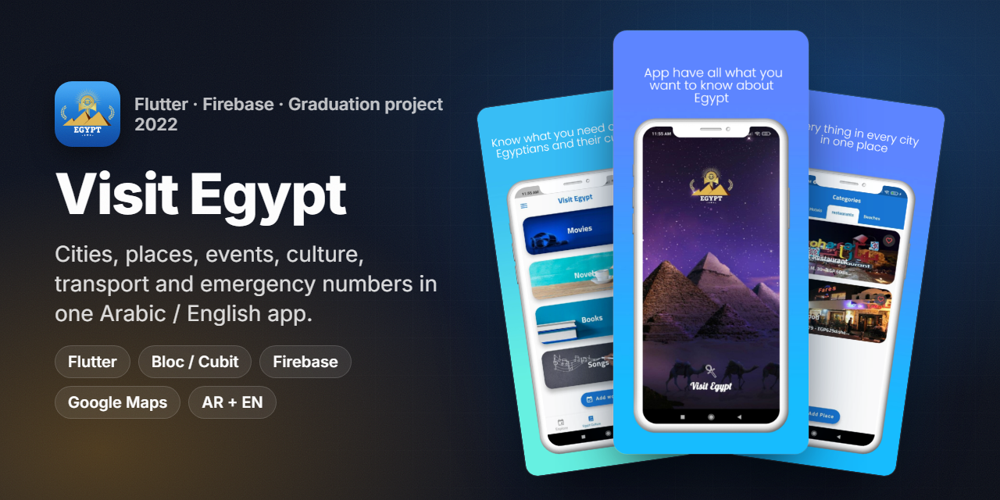
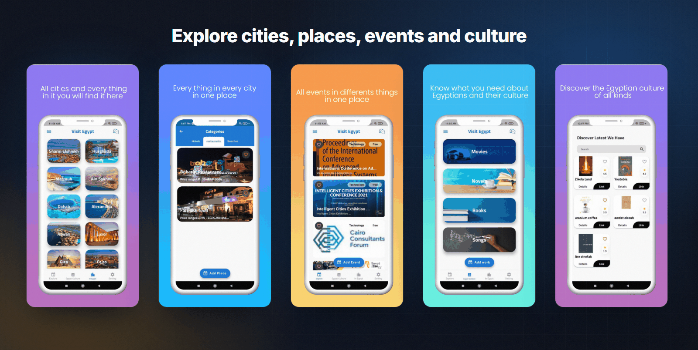
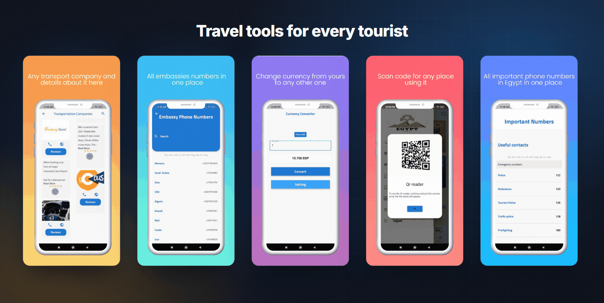
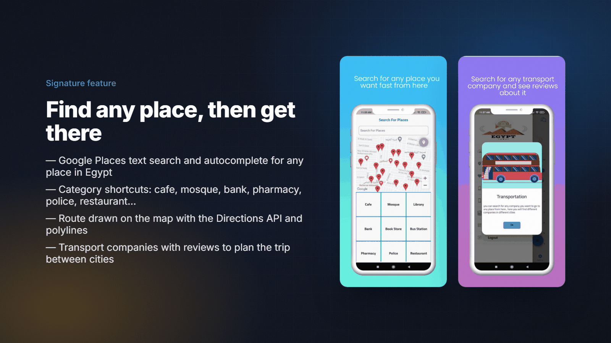
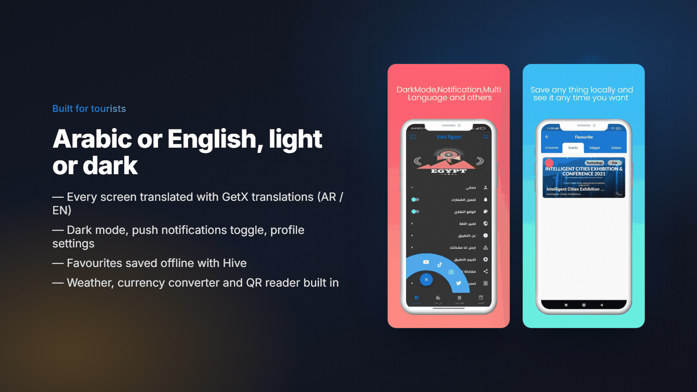
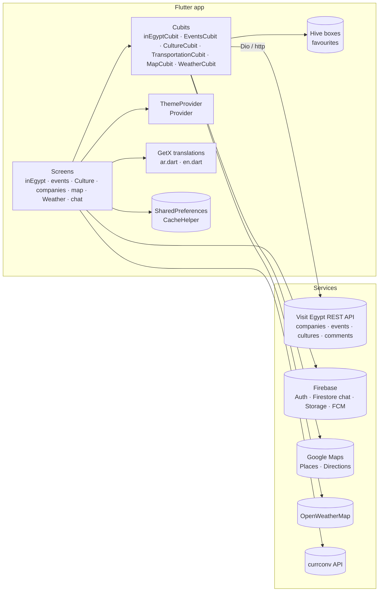

<p align="center"></p>
<h1 align="center">Visit Egypt</h1>
<p align="center"><b>A bilingual (Arabic / English) tourism guide for Egypt: cities, places, events, culture, transport, maps, weather and chat in one Flutter app.</b></p>
<p align="center">
  
  
  
  
  
  
  
</p>

## Overview

**Visit Egypt** answers the questions a tourist has inside Egypt: *what is in this city, what is happening this week, how do I get there,
and who do I call if something goes wrong?* It lists places in every city (hotels, restaurants, beaches), events of all kinds, Egyptian culture
(movies, novels, books, songs), transport and tourism companies with reviews, embassy and emergency numbers, a map with place search
and directions, weather, a currency converter, a QR reader and chat between users. All content is shown in **Arabic and English**.

| | |
|---|---|
| **Type** | University graduation project (team), 2021–2022 |
| **My role** | Lead Flutter developer: app architecture, most screens and features, Firebase integration, release |
| **Team** | See [Acknowledgements](#acknowledgements) |
| **Store ID** | Published on Google Play as `com.visit_egypt` (listing no longer available) |

## The challenge

- Tourist information about Egypt is **spread across many sites and apps**, and much of it is available in only one language.
- Content changes all the time (events, places, companies), so it had to come from a **backend that the team can update**, not be hard-coded.
- Tourists need practical tools that keep working when connectivity is bad: **saved favourites offline**, emergency numbers and directions.

## Highlights

**🗺️ Discover**
- **In Egypt:** every city (Sharm El-Sheikh, Hurghada, Dahab, Aswan, Luxor, Cairo...) with places by category: hotels, restaurants, beaches
- **Events:** conferences, exhibitions and festivals with category and price tags
- **Egypt culture:** movies, novels, books and songs, with details and external links
- Users can **add a place, an event or a cultural work** and **comment and rate** every item

**🧭 Get around**
- **Map:** Google Places text search and autocomplete, category shortcuts (cafe, mosque, bank, pharmacy, police...) and routes drawn with the Directions API
- **Transportation:** transport and tourism companies with contacts, links and user reviews
- **Weather:** current conditions and forecast for any Egyptian city (OpenWeatherMap), with charts
- **Currency converter** and **QR code reader**

**🆘 Stay safe**
- Emergency numbers (police, ambulance, tourism police, fire...) and **embassy numbers** for many countries: tap to call, long-press to copy

**👤 Account & experience**
- Sign in with email and password, **Google** or **Facebook** (Firebase Auth), profile editing (name, photo, email, password, phone)
- **Chat** with other users and with the admin (Cloud Firestore)
- **Favourites saved offline** with Hive, per section (companies, events, places, culture)
- Arabic / English switch, **dark mode**, push notifications (FCM) with an on/off toggle, onboarding with a video background

## Screens

<p align="center"></p>
<p align="center"></p>
<p align="center"><sub>Store-listing images from the released app.</sub></p>

## Signature feature

<p align="center"></p>

The map module ([`lib/Screens/map`](lib/Screens/map)) is built on a `MapCubit` and a small `DioHelper` client for Google Maps web services:

1. **Search:** typing calls the Places **Autocomplete** endpoint and selecting a result calls **Place Details**. Category tiles run a Places **Text Search** (for example "pharmacy in Cairo").
2. **Show:** results become markers on `GoogleMap`, and the user's position comes from `geolocator`.
3. **Route:** [`mapTrack_screen.dart`](lib/Screens/map/mapTrack_screen.dart) calls the **Directions API**, decodes the polyline with `flutter_polyline_points` and draws the route.

<p align="center"></p>

## Architecture & stack



| Layer | Tech (from `pubspec.yaml`) |
|---|---|
| UI | Flutter (Material), `google_fonts`, `flutter_staggered_grid_view`, `fab_circular_menu`, `flip_card`, `animations`, `video_player` |
| State | `flutter_bloc` (Cubits per feature + `BlocObserver`), `provider` (theme), `get` (navigation and translations) |
| Networking | `dio` (Google Maps, content API), `http` (weather, currency) |
| Backend | `firebase_auth`, `cloud_firestore`, `firebase_storage`, `firebase_messaging` |
| Auth providers | Email / password, `google_sign_in`, `flutter_login_facebook` |
| Maps | `google_maps_flutter`, `geolocator`, `flutter_polyline_points` |
| Local storage | `hive` + `hive_flutter` (favourites, generated adapters), `shared_preferences` |
| Tools | `qr_code_scanner`, `syncfusion_flutter_charts`, `url_launcher`, `flutter_email_sender`, `image_picker`, `file_picker` |

## Engineering notes

- **Bilingual content from one API.** Each content type has `/en` and `/ar` endpoints (`companiesEn` / `companiesAr`, `eventsEn` / `eventsAr`...). The cubits pick the endpoint from the current GetX locale, and the UI strings come from GetX `Translations`, so both content and chrome change language together.
- **Offline favourites.** Favourites are Hive objects with generated `TypeAdapter`s (`*.g.dart`), one box per section (`favBox`, `favEventBox`, `favPlacesBox`, `favCultureBox`), opened once in `main()` before `runApp`.
- **Feature-scoped Cubits.** Every feature has its own `cubit.dart` + `states.dart`, provided once at the root with `MultiBlocProvider`. A `BlocObserver` logs transitions while debugging.
- **Secrets out of the repo.** API keys and the backend URL are read from `--dart-define` through [`lib/config/env.dart`](lib/config/env.dart). The Android Maps key is injected with a manifest placeholder and the iOS key from `Info.plist`.
- **First-run flow.** `CacheHelper` stores a `firstOpen` flag: new users get the onboarding (with a video background), and returning users go straight to the splash and home.

## Getting started

> This is a **2022 codebase**. It targets **Flutter 2.x** with null safety (`sdk: ">=2.12.0 <3.0.0"`, dependencies resolved with Dart 2.14+).
> It does not resolve on Flutter 3 / Dart 3 as is: some pinned packages (for example `full_screen_image`) have no Dart 3 release.
>
> **Verified:** with Flutter **2.10.5**, `flutter pub get` resolves and `flutter analyze` reports **0 errors and 0 warnings** (197 info-level lints, mostly deprecations and naming).

```bash
# Use a Flutter 2.x SDK, for example 2.10.5
fvm install 2.10.5 && fvm use 2.10.5

# 1. Firebase
cp android/app/google-services.json.example android/app/google-services.json   # paste your config
#    iOS: add ios/Runner/GoogleService-Info.plist

# 2. Google Maps key for the native SDKs
echo "MAPS_API_KEY=your-key" >> android/local.properties                       # Android
#    iOS: set GMSApiKey in ios/Runner/Info.plist

# 3. Run with the runtime config (see env.example.json)
fvm flutter pub get
fvm flutter run \
  --dart-define=MAPS_API_KEY=your-key \
  --dart-define=API_BASE_URL=https://your-backend/api \
  --dart-define=OPENWEATHER_API_KEY=your-key \
  --dart-define=CURRCONV_API_KEY=your-key \
  --dart-define=SUPPORT_EMAIL=support@example.com \
  --dart-define=SUPPORT_WHATSAPP=201000000000
```

## Project structure

```
lib/
├── main.dart                  # Firebase, Hive, Dio, BlocObserver, MultiBlocProvider, GetMaterialApp
├── config/env.dart            # --dart-define configuration (keys, base URL)
├── Screens/
│   ├── inEgypt/               # Cities, categories, place details, add place, comments (+ cubit, Hive model)
│   ├── events/                # Events list, details, add event, comments (+ cubit, Hive model)
│   ├── Culture/               # Movies, novels, books, songs (+ cubit, Hive model)
│   ├── companies/             # Transportation companies + reviews (+ cubit, Hive model)
│   ├── map/                   # Places search, categories, directions (MapCubit)
│   ├── Weather/               # Current weather + forecast (WeatherCubit)
│   ├── CurrencyConverter/     # Currency conversion
│   ├── SignUpScreens/         # Login, sign-up, forgot password (Email, Google, Facebook)
│   ├── UpdateProfile/         # Name, photo, email, password, phone
│   ├── favourites/            # Offline favourites per section
│   ├── chatAdmin/ · chat_screen.dart
│   └── qrCodeScreen.dart · EmbassyPhonesScreen.dart · egypt_phone_numper_screen.dart · settingScreen.dart
├── Services/                  # Auth, Firestore chat/users, storage access, currency API
├── shared/                    # BlocObserver, CacheHelper, DioHelper, API endpoints
├── Models/ · Widgets/ · Components/ · Utils/langs/ · constants/ · controller/
assets/                        # Logos, GIFs, weather icons, intro video
docs/assets/                   # README images (+ _src/render.json)
```

## State management

- **Bloc / Cubit** for every data feature (`inEgyptCubit`, `EventsCubit`, `CultureCubit`, `TransportationCubit`, `MapCubit`, `WeatherCubit`, `userCubit`), each with explicit loading / success / error states.
- **Provider** for the app theme (`ThemeProvider`, persisted with `SharedPreferences`).
- **GetX** for navigation helpers, snackbars and the `Translations` map (Arabic / English).

## Configuration

| Key | Used for | How to set |
|---|---|---|
| `MAPS_API_KEY` | Places / Directions web services | `--dart-define` |
| Native Maps key | Android / iOS map SDKs | `android/local.properties` → `MAPS_API_KEY`, iOS `Info.plist` → `GMSApiKey` |
| `API_BASE_URL` | Content API (companies, events, cultures, comments) | `--dart-define` |
| `OPENWEATHER_API_KEY` | Weather screen | `--dart-define` |
| `CURRCONV_API_KEY` | Currency converter | `--dart-define` |
| `SUPPORT_EMAIL`, `SUPPORT_WHATSAPP` | Report-a-problem e-mail, WhatsApp contact | `--dart-define` |
| Firebase | Auth, Firestore, Storage, FCM | `google-services.json` / `GoogleService-Info.plist` (git-ignored) |
| Facebook login | `facebook_app_id` | `android/app/src/main/res/values/strings.xml` |

A template with every key is in [`env.example.json`](env.example.json). Real values are never committed.

## Known limitations

- `lib/Screens/arPlaces.dart` is an **AR experiment (ARCore) that is commented out**, together with its side-menu entry. It is kept for reference and does not affect the build.
- The content backend used during the project is no longer online. Point `API_BASE_URL` to your own API with the same endpoints to see the content screens.

## Acknowledgements

Visit Egypt was a **team graduation project**. The Flutter app in this repository was built by:

- **Mahmoud Shaker** ([@ANaSHaker](https://github.com/ANaSHaker)): app architecture and most features
- **@mrezk319** ([GitHub](https://github.com/mrezk319)): contributions to the map, weather, culture, events and chat screens and the translations

The commit history was squashed for this public copy. The original repository shows commits from both contributors.

## Results

- Published on Google Play as `com.visit_egypt` and presented as a graduation project in 2022. The listing and the demo website are no longer live, so no usage numbers are claimed.

## Contributing

This is a portfolio snapshot. Issues and pull requests are welcome, especially a migration to Flutter 3 / Dart 3.

## License

Source is shared for portfolio and learning purposes. All rights reserved by the authors unless agreed otherwise. Images of places and brands belong to their owners.

## بالعربي

**Visit Egypt** تطبيق سياحي بالعربي والإنجليزي، بيجمع كل اللي السائح محتاجه جوه مصر: الأماكن في كل مدينة، الفعاليات، الثقافة المصرية (أفلام، روايات، كتب، أغاني)،
شركات النقل وتقييماتها، أرقام الطوارئ والسفارات، وخريطة فيها بحث عن الأماكن ومسار الوصول، والطقس، وتحويل العملات، وقارئ QR، وشات بين المستخدمين.
كان مشروع تخرج جماعي سنة 2022، واشتغلت فيه كمطوّر Flutter رئيسي ومسؤول عن المعمارية وأغلب الشاشات.
مبني بـ Bloc/Cubit وFirebase وGoogle Maps وHive، وفيه وضع داكن ودعم لغتين.

## Links

- Source: this repository

---
<h3 align="center">Built by Mahmoud Shaker — Senior Flutter Engineer</h3>
<p align="center">
  <a href="https://wa.me/201140279111"></a>
  <a href="https://www.linkedin.com/in/anashaker/"></a>
  <a href="https://anashaker.github.io/shaker_portfolio/"></a>
  <a href="mailto:mahmoudshaker382001@gmail.com"></a>
  <a href="https://khamsat.com/user/sheko201566"></a>
  <a href="https://mostaql.com/u/ShekoShaker"></a>
  <a href="https://github.com/ANaSHaker"></a>
</p>
